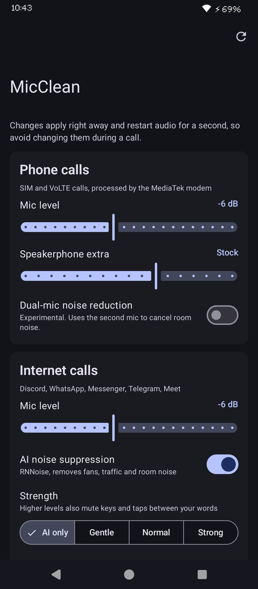
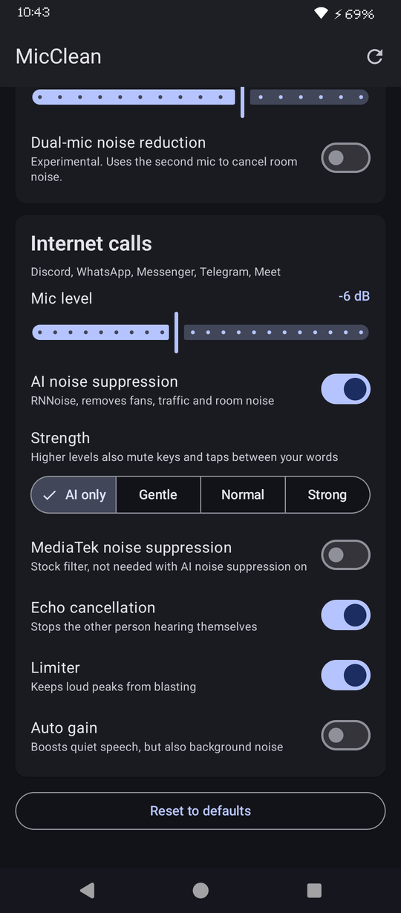

# MicClean

**AI noise suppression and mic tuning for calls on MediaTek phones, as a Magisk module plus a Material 3 control app.**

MicClean runs [RNNoise](https://github.com/xiph/rnnoise), a small neural noise suppressor, on your mic during internet calls (Discord, WhatsApp, Messenger, Telegram, Meet). It removes fans, keyboard clicks, taps and room noise before the other person hears them. It also lowers the overly hot mic gain MediaTek ships for both SIM and internet calls. Everything is systemless, so removing the module restores stock.

Built and tested on a **Tecno Spark 10 Pro (KI7, Helio G88 / mt6768)** running **crDroid 10.5 (Android 14 GSI)** with **Magisk 31.1**.

<p align="center">
  
</p>

<p align="center">
  
  &nbsp;&nbsp;
  
</p>

## Features

| | Internet calls (Discord, WhatsApp...) | SIM / VoLTE calls |
|---|---|---|
| AI noise suppression (RNNoise 0.2) | ✅ | ❌ (see [limits](#limits)) |
| Voice gate that mutes keys/taps between words (4 strengths) | ✅ | ❌ |
| Mic gain adjustment (−15 to +6 dB) | ✅ | ✅ |
| Extra speakerphone gain trim | | ✅ |
| MediaTek dual-mic noise reduction (experimental) | | ✅ |
| Toggle MediaTek NS / echo cancel / auto gain / limiter | ✅ | |

- **Lightweight:** it uses about 6% of one CPU core, and only while a call is using the mic.
- **Material 3 app** with dynamic (wallpaper) colors. Changes apply instantly, with no reboot.
- **CLI included:** `su -c micclean status | set NAME VALUE | apply | reset`.

## How it works

On this MediaTek platform, Android's normal audio-effect chain is **not used for VoIP capture**. The vendor audio HAL attaches only an echo-canceller-type effect, and its Aurisys capture path skips Android effects for VoIP streams. A regular Android noise-suppression effect therefore never touches Discord or WhatsApp audio.

MicClean hooks in where the HAL actually processes VoIP audio, which is **Aurisys**, MediaTek's audio plugin framework:

```
mic ─► MediaTek HAL ─► Aurisys VoIP uplink ─► [ lib_speech_enh (MediaTek AEC/NS) ─► RNNoise + voice gate ] ─► app
                                                └──────────── libmicclean_aurisys.so ────────────┘
```

`libmicclean_aurisys.so` registers as an Aurisys library (`micclean_enh`) for the VoIP scenarios in `aurisys_config.xml`. It loads MediaTek's real `lib_speech_enh.so` and hands its function table to the HAL unchanged, except for the uplink process call. That call is wrapped so RNNoise runs on MediaTek's output (16 kHz, mono, 16-bit, 20 ms frames). The result keeps MediaTek's echo cancellation and adds a neural denoiser on top.

Mic gains are patched in MediaTek's `SpeechVol_AudioParam.xml` (SIM calls) and `VoIPVol_AudioParam.xml` (internet calls). All patched files are overlaid systemlessly by Magisk from the module folder.

## Install

1. Download `MicClean-v1.3.zip` and `MicClean-app.apk` from [Releases](../../releases).
2. Magisk → Modules → **Install from storage** → pick the zip → reboot.
3. Install the APK, open **MicClean**, and tap **Grant** in the Magisk root prompt.

From a PC instead:

```bash
adb push MicClean-v1.3.zip /sdcard/Download/
adb shell su -c "magisk --install-module /sdcard/Download/MicClean-v1.3.zip"
adb install MicClean-app.apk
adb reboot
```

## Usage

Use the app, or the CLI over `adb shell` or Termux:

```bash
su -c micclean status                          # current settings and active gains
su -c micclean set VOIP_RNNOISE_STRENGTH 3     # 0 AI only, 1 gentle, 2 normal, 3 strong
su -c micclean set CALL_MIC_OFFSET -8          # SIM calls 8 dB quieter than stock
su -c micclean set VOIP_MIC_OFFSET -6          # internet calls
su -c micclean set CALL_DUALMIC 1              # experimental dual-mic NR on SIM calls
su -c micclean reset                           # defaults
```

Each change restarts the audio service for about a second, so change settings between calls. Settings are stored in `/data/adb/micclean/config`.

| Setting | Default | Meaning |
|---|---|---|
| `CALL_MIC_OFFSET` | −6 | SIM call mic gain change in dB (0 = stock) |
| `CALL_SPK_OFFSET` | 0 | Extra change for speakerphone SIM calls |
| `CALL_DUALMIC` | 0 | MediaTek dual-mic noise reduction (Tecno ships it disabled) |
| `VOIP_MIC_OFFSET` | −6 | Internet call mic gain change in dB |
| `VOIP_RNNOISE` | 1 | AI noise suppression |
| `VOIP_RNNOISE_STRENGTH` | 2 | Voice gate: 0 off, 1 gentle, 2 normal, 3 strong |
| `VOIP_AEC` / `VOIP_NS` / `VOIP_AGC` / `VOIP_LIMITER` | 1 / 0 / 0 / 1 | Android effect chain toggles |

## Limits

- **SIM calls can't get AI noise suppression.** On this phone, SIM call audio goes straight from the mic to the modem's speech DSP and never passes through Android. Any app or module has the same limit. MicClean adjusts the modem's mic gain and can enable MediaTek's dual-mic noise reduction instead.
- **Keys typed while you're talking** are reduced but not fully removed. The voice gate mutes noise between words, not under them.
- **Device-specific:** the Aurisys hook targets MediaTek HALs that use `lib_speech_enh.so` (`mtk_speech_enh`) for VoIP. The installer aborts on non-MediaTek devices. Other MediaTek phones may work, but they're untested.

## Uninstall and recovery

- Magisk → Modules → MicClean → **Remove** → reboot. Nothing on `/vendor` or `/system` was modified.
- **Bootloop?** Power on and keep pressing **Volume Down** from the boot logo until the lock screen (Magisk safe mode disables all modules). Or from a PC:
  ```bash
  adb wait-for-device shell magisk --remove-modules
  ```
- **No sound or mic after a change:** `su -c micclean reset`. If that doesn't fix it, remove the module.

## Building from source

```bash
# 1. native plugin (needs Android NDK r27c)
ANDROID_NDK_HOME=/path/to/android-ndk-r27c ./native/build.sh

# 2. flashable module -> dist/MicClean-<version>.zip
python3 package.py

# 3. app (needs JDK 17 + Android SDK 34)
cd app && ./gradlew assembleRelease
```

Repo layout:

```
module/   Magisk module: installer, config patchers, micclean CLI
native/   libmicclean_aurisys.c, the Aurisys shim + RNNoise wrapper
app/      Jetpack Compose Material 3 control app
docs/     screenshots
```

## License

MIT, see [LICENSE](LICENSE). RNNoise is BSD-3-Clause; see [THIRD_PARTY_NOTICES.md](THIRD_PARTY_NOTICES.md).
